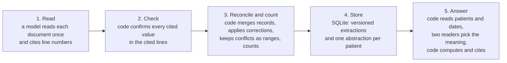

# Clinical abstraction for behavioral-health records

Code answers the five development questions from a saved abstraction, in about 0.3 s each, and cites source lines for every number.
A model reads each document once and cites line numbers.
Code checks every cited value, merges the records into one row per real contact, keeps conflicts as ranges, and does all the counting.
On the supplied record, 95 of 95 gold checks pass with a cheap model (Haiku 5.5, $0.04) and with a larger model (Sonnet 5.5, $0.525).

## Results (measured)

| Measure | Result | Evidence |
|---|---|---|
| Gold checks, supplied record (1 patient, 31 documents) | 95 of 95 with Sonnet 5.5, and with Haiku 5.5 on both prompt versions | `outputs/abstraction.db` |
| Gold checks, held-out patient (15 files, another format) | 53 of 53 with Haiku 5.5, on the first run | `outputs/experiments/held-out/` |
| Synthetic truth (25 patients, 319 files, 311 unique) | Haiku 5.5: 25 of 25 patients and 1,841 of 1,841 checks in each of three passes, after a first pass that scored 20 of 25 (1,813 of 1,841). Sonnet 5.5 on 12 patients: 877 of 877 | `outputs/experiments/tier-*.json`, `docs/experiments.md` run 4 |
| Five development answers | All computed by code, 0.27 to 0.39 s each. `verify-answers` replays them with no model | `outputs/answers/` |
| A new document arrives (an addendum) | 1 model call, $0.029, 5.0 s, 1 patient rebuilt. Week 4 changes from cannot be determined to not met | `outputs/experiments/new-document/` |
| Meaning of 54 questions | Two readers: metric right 0.926, attendance right 0.870. Keyword rules alone: 0.519 and 0.481. Decision model alone: 0.574 and 0.574 | `outputs/experiments/routing-*.json` |
| Spend for the whole build | $3.36 Claude and $0.10 Jev, at list prices | `outputs/benchmarks.json` |

A gold check compares one value in the abstraction with a label written in advance (`evals/gold/`).
The coding assistant derived the gold labels for the supplied record, and the builder of the pipeline wrote the synthetic truth, so neither is independent yet.

## The five answers

- [DEV-01](outputs/answers/DEV-01.md): 12 therapy sessions on 11 distinct days (5 individual, 5 group, 2 family), with 13 other records listed and explained.
- [DEV-02](outputs/answers/DEV-02.md): 585 to 595 minutes (9.75 to 9.92 hours), and by week 140, 120, 180, and 145 to 155.
- [DEV-03](outputs/answers/DEV-03.md): weeks 1 and 2 not met, week 3 met, week 4 cannot be determined (145 to 155 minutes against a goal of 150).
- [DEV-04](outputs/answers/DEV-04.md): January 19 has 2 contacts and 90 minutes, January 21 has 1 video contact and 45 minutes, and a warning notes that the two readers disagree on attendance.
- [DEV-05](outputs/answers/DEV-05.md): the PHQ-9 total fell 8 points across 3 distinct administrations (18, 14, 10), the later import is a copy, and causation and treatment response are not supported.

## How it works



Code does all checking, merging, counting, ranges, rendering, and replay, so the same extractions give the same numbers on every run.
Models read documents (Claude), second-read four labels and read each question next to the keyword rules (Jev, the decision model), and answer open questions through read-only tools (a Claude agent).

Work is reused across questions and runs:

- A question reads the saved tables, never the documents.
- A re-run or a duplicate file makes 0 model calls and rebuilds nothing (0.009 s for a re-run).
- A new document is read once, and only its patient is rebuilt.
- A new prompt or model adds extraction rows under a new version, and the old rows stay.

## How to run

```bash
uv sync --frozen                                    # Python 3.12, locked dependencies
uv run --frozen abstraction ingest documents/       # Sonnet 5.5 (--model claude-haiku-5-5 for the cheap tier); the saved store has nothing new
uv run --frozen abstraction source "BH-D103 L7"     # print the source lines behind a citation
uv run --frozen abstraction ask "How many minutes of therapy did Rowan receive in the week of January 12?"
uv run --frozen abstraction answer-questions questions.json   # write outputs/answers/
uv run --frozen abstraction verify-answers          # replay saved answers with no model
uv run --frozen python -m evals.benchmark --patients 50 --db outputs/abstraction.db --out outputs/quick   # about 5 s
uv run --frozen pytest -q && uv run --frozen ruff check .
```

Without flags, the benchmark builds 1, 2,000, and 20,000 patients (4 GB, minutes) and overwrites `outputs/benchmarks.json`.
To add a document, work on a copy of the store, and use the model that built it.
Another model reads every document again under a new version.

```bash
cp outputs/abstraction.db outputs/demo.db
uv run --frozen abstraction --db outputs/demo.db --out outputs/demo ingest examples/new_document/
```

To run the experiments:

```bash
uv run --frozen python -m evals.synthetic --seed 7 --patients 25 --out outputs/experiments/synthetic
uv run --frozen python -m evals.experiments routing --arm agreement --db outputs/experiments/held-out/abstraction.db   # arms: rules, jev, agreement; the store needs both example patients
uv run --frozen python -m evals.experiments tier --model claude-haiku-5-5 --store outputs/experiments/tier-haiku-run1/abstraction.db
```

- No key needed: `report`, `source`, `verify-answers`, `pytest`, `ruff`, `evals.benchmark`, `evals.synthetic`, `routing --arm rules`, `tier --store`.
- `ask` runs without a key on keyword rules alone, and every answer says so.
- `ANTHROPIC_API_KEY`: `ingest`, open questions (`ask --agent`), `tier` without `--store`.
- `JEV_API_KEY`: the second read inside `ingest`, `ask`, `answer-questions`, `routing --arm jev`, and `routing --arm agreement`.
- Keys come from the environment, or from `~/.config/backbone-take-home/anthropic.env` and `jev.env` (`KEY=value` lines).
- Spend caps are `MODEL_BUDGET_USD` (default 10) and `JEV_BUDGET_USD` (default 0.50).

## Design decision tested: cheap tier or frontier tier

Question: can the cheap tier (Haiku 5.5, about 11 times cheaper) read documents well enough when code checks and decides?
The frontier tier is Sonnet 5.5, the larger model.
Test: 25 synthetic patients with known truth (seed 7, 3 templates, hazards at fixed rates), with exact checks.

The first Haiku pass scored 20 of 25 patients (1,813 of 1,841 checks).
Two causes explain all 28 failing checks:

- An addendum settled two conflicting notes, but its correction was labelled `other`, so code did not apply it (4 patients).
- One signed record stated minutes for two contacts but gave no times, so neither counted (1 patient; 10 of 12 sessions counted).

Code now applies time corrections labelled `other` and counts stated minutes, and the prompt names both cases.
Rebuilding the first pass with the new code, with no model call, scored 25 of 25.
Three Haiku passes on the new prompt each scored 25 of 25 (1,841 of 1,841), at about $0.27 and 235 s.
Sonnet scored 877 of 877 on 12 of the patients for $1.52, and Haiku cost $0.13 for the same 12.

What the test showed: both tiers pass, so the cheap tier is enough for reading when code checks values and decides.
The gaps sat in the reconciler and the prompt.
Model skill was not the cause.
Sonnet wrote half the output tokens on the supplied record (29,779 against 59,499) and never needed a second call.
Haiku needed a second call for 2 of 31 supplied documents and for 7 to 12 of 311 synthetic documents per pass, mostly after a cut-off at 3,000 tokens.

Honest notes: the same builder wrote the generator and the pipeline, so one blind spot can sit in both.
The 25 of 25 scores come after tuning on this set.
The held-out patient (another format, written before the pipeline saw it) passed 53 of 53 on the first run, before the fixes.

Second measured decision: two readers for the meaning of a question.
54 questions (5 development, 34 from the review of the previous attempt, 15 paraphrases) were read by each reader alone and by both.
A refusal counts as a miss, except for the 4 questions that should be refused.

| Reader | Metric right | Attendance right | Dates right | Wrong plan printed as plain COMPUTED |
|---|---|---|---|---|
| Keyword rules alone | 0.519 | 0.481 | 0.574 | 0 (rules alone never print plain COMPUTED) |
| Decision model alone | 0.574 | 0.574 | 0.593 | 1 |
| Both readers | 0.926 | 0.870 | 1.000 | 0 |

Each reader alone refuses 22 to 23 of the 50 answerable questions.
Together they answer all 50, and each of the 7 wrong plans carries a warning.
The study found one real failure: the decision model alone answered "average weekly therapy time per patient" as plain minutes.
Words such as average and ratio now send a question to the open path, because no renderer computes an average.

## Observed limitation: reading the question

7 of the 54 plans differ from the expected reading (DEV-04, REVIEW-03, REVIEW-18, REVIEW-21, REVIEW-27, REVIEW-34, PARAPHRASE-04).
All 7 print COMPUTED WITH WARNING with both readings, and none prints a plain COMPUTED.
All 7 misread the attendance filter, and 4 also misread the metric.
Questions that name no filter are the weak spot: "What happened on Jan. 19?" reads attendance as not applicable at 0.51.
One warning points at the wrong field: REVIEW-34 asks about authorizations, both readers agreed on sessions, and only attendance raised the warning.

Next steps:

1. Collect real reviewer questions.
   The 54 come from the builder and from a review of the previous attempt.
2. Run them through the routing experiment, locally and in Langfuse.
3. Tune the criteria text and the 0.9 bar on that set before trusting a new value.
4. When the readers disagree, ask a clarifying question instead of computing with a warning (not built).

## Other gaps

- A week number ("week 2") is refused, because weeks differ by patient, and a clinician name is refused as an unknown patient.
- A date with no year matches any year in the referee, and a question date takes the year of the earliest service in the store.
- Coverage notes are noisy: one of the six flags on the supplied record is a false alarm (BH-D015 L9 is the time reception saw a no-show).
- A correction of a date, service type, or other field raises `correction_not_applied` and is not applied.
- A failed second read is repeated by the next ingest, not inside one run.
- Patient ids are found by labels (`MRN`, `Record #`, `Medical record`), so a document with no id stays unassigned and `ingest` exits 1.
- Partial weeks are judged against the full weekly goal (week 4 of the supplied record runs Monday to Friday).
- Only one real patient exists, so collection results come from synthetic or copied patients.

## Performance (measured)

| Measure | Result |
|---|---|
| Initial processing, 31 supplied documents, 8 workers | Sonnet 5.5: 23.4 s, 31 calls, $0.525. Haiku 5.5: 41.4 s, 33 calls, $0.042 |
| Initial processing, 311 synthetic documents, Haiku 5.5 | 229 to 240 s in three passes (1.3 documents/s), $0.27 to $0.28 |
| Re-run with nothing new | 0.009 s, 0 model calls, 0 patients rebuilt |
| New document (addendum), Sonnet 5.5 | 5.0 s, 1 call, $0.029, 1 patient rebuilt |
| One new document, code only, median of 5 | 0.05 s at 31 documents; 0.09 s at 62,000; 2.4 s at 620,000 |
| Individual-patient question, code only (decision model faked) | 0.5 to 1.5 ms at 1 patient; 9 ms at 2,000 patients (slowest of 3 runs: 1.1 s) |
| Individual-patient question, with the decision model | 0.27 to 0.39 s, about $0.00005 |
| Collection question, 2,000 patients (two weeks below goal) | 30 ms median, 824 characters; a question that names no patient lists at most 50 patients, then a count |
| Saved abstraction, supplied record | SQLite 516 KB (31 documents, 3 extractor versions); abstraction JSON 41 KB; Markdown 18 KB |
| Store size, copies of one patient, one extractor version | 412 MB at 62,000 documents; 4.1 GB at 620,000 |

The 2,000 and 20,000 patients are copies of the one real patient with new ids (sources: `outputs/benchmarks.json`, `outputs/answers/answers.json`).

## First bottleneck at one million documents: extraction

One model call reads each document (`extract.extract_document`, run by the worker pool in `pipeline.extract_missing`).
Output tokens are most of the cost: 70 percent for Haiku and 57 percent for Sonnet on the supplied record.

| For 1,000,000 documents | Haiku 5.5 | Sonnet 5.5 |
|---|---|---|
| Measured cost per document (synthetic set to supplied record) | $0.0009 to $0.0014 | $0.0100 to $0.0169 |
| Cost at list price, no batch discount (estimate) | $900 to $1,400 | $10,000 to $17,000 |
| Measured throughput, 8 workers | 1.3 documents/s | 1.6 documents/s |
| Time at 8 workers (estimate) | 8.8 days | 7.1 days |

Changes, in order: cut what the model writes, use the cheapest tier that passes the gold gate, run backfills as batch inference at half price (not tested), then add workers.
The Jev second read adds about $0.00008 per document (estimate: $77 per million).

The next two limits:

1. The tokens-per-minute quota comes next: at 8 workers the Haiku passes used about 119,000 output and 36,000 uncached input tokens per minute (measured).
   A one-day run needs about 70 workers and 1 million output tokens per minute (estimate), and the quota of the account was not measured.
   The change is a queue with per-minute token accounting around `llm.call_anthropic` and the pool in `pipeline.extract_missing`.
2. The write path comes after: one new document costs 0.09 s of code at 62,000 documents and 2.4 s at 620,000 (measured, no model, not profiled).
   `pipeline.extract_missing` and `pipeline.backfill_label_checks` scan every document and extraction row to find pending work, and `store.connect` gives SQLite one writer per file.
   The change is a pending-work table, then Postgres when more than one process writes.
   `llm.Budget.charge` and `jev.Jev.ask` also rewrite a whole JSON file on every call, about 155 MB per call at a million ledger entries (estimate), so both should move into SQLite.

## Models, settings, and coding assistance

- Extraction: `claude-sonnet-5-5` built the main store and `claude-haiku-5-5` is the cheap tier, both through the Anthropic API.
- Settings: one `record_extraction` tool call per document, checked by Pydantic, with a cached system prompt and the temperature not set (API default).
- Limits: `max_tokens` 3,000 with one retry at 8,000 after a cut-off, 3 tries to match the schema, one repair turn when the referee rejects values, 8 worker threads, and 4 SDK retries.
- Decision model: Jev `jev-latest` (every cached answer reports `jev-1.13.0`) at `https://api.typesafe.ai/v1/systemone`, with an on-disk cache and agreement and dispute bars of 0.9.
- Open questions: Claude Sonnet 5.5 with 4 read-only tools and at most 8 calls, and code checks every number against the tool results.
- List prices (2026-10-17), per million tokens: Sonnet 5.5 $2 input and $10 output; Haiku 5.5 $0.10 and $0.50; Jev $0.042 input.
- Coding assistance: Claude Code.
  The orchestrating session ran Claude Fable 5.1 and Claude Opus 5.5.
  Implementers ran Claude Sonnet 5.5 and Claude Opus 5.5 on test-first tasks, and research subagents ran Claude Sonnet 5.5.
- The coding assistant derived the gold labels for the supplied record, and a person has not confirmed them yet.
  `docs/gold-checklist.md` prints every cited source line under each of its 24 rows.
- Runtime and cost: see the two tables above, and the ledgers `outputs/**/logs/spend.json` with caps of $10 and $0.50.

## Repository map

- `src/clinical_abstraction/`: `schema`, `verify` (the referee), `extract`, `jev`, `llm` (calls, prices, budget), `reconcile`, `calculate`, `store`, `pipeline`, `render`, `questions`, `answers`, `agent`, `cli`.
- `evals/`: gold files, `score.py`, `synthetic.py`, `experiments.py` (routing and tier), `benchmark.py`, `questions.json` (54 questions).
- `tests/`: 202 tests, and none calls a model.
- `documents/`, `questions.json`, `examples/`: the supplied record (31 documents), the five development questions, a held-out patient (15 files), and one new addendum (the examples are synthetic).
- `outputs/`: the saved store, abstraction exports, answers, logs, experiments, and `benchmarks.json`.
- `docs/`, `AGENTS.md`, `HANDOFF.md`: rules and why (`design.md`), every run (`experiments.md`), decisions, the gold checklist, plans, working rules, and the state at hand-over.
- `Dockerfile`, `.github/workflows/ci.yml`: the image builds in CI, never on a laptop.
